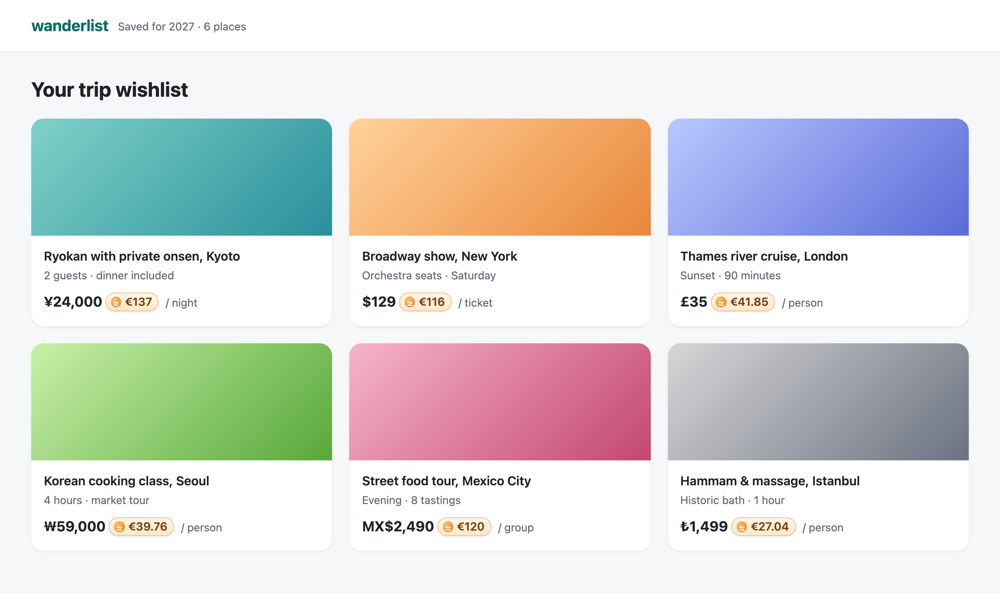

<p align="center">
  
</p>

<h1 align="center">DirectChange</h1>

<p align="center">
  <b>Every price on the web, in your own currency, at today's live rate.</b><br>
  A tiny browser extension: no account, no tracking, no build step.
</p>

<p align="center">
  <a href="https://xeewi.github.io/directchange/">Website</a> ·
  <a href="#install">Install</a> ·
  <a href="#how-it-works">How it works</a> ·
  <a href="#translations">Translations</a>
</p>

<p align="center">
  
</p>

## Why

You're booking a ryokan in Kyoto and the site says **¥24,000** a night. Is that a lot? DirectChange
answers right there on the page, with a small pill next to the price: **≈ €137**. Hover it for the exact rate
and when it was fetched.

## Features

- **Inline conversions.** A small badge right after each foreign price, styled to blend into any site
  (light or dark). It lives in a Shadow DOM, so the site's CSS can't break it.
- **Live rates.** Rates come from Coinbase's public API (near real time) and are refreshed every
  10 minutes, with open.er-api.com (daily) as a fallback. 150+ currencies.
- **Reads prices the way people write them.** `¥24,000`, `1.234,56 €`, `MX$2,490`, `USD 45`,
  `14 000 bahts`, `Rs 900`… even prices split across several HTML tags.
- **Knows where the site is.** A plain `$` on a `.ca` site is Canadian dollars, `¥` on a `.cn` site is
  yuan, `kr` on a `.no` site is Norwegian krone. See [how it decides](#which-currency-is-).
- **Dynamic pages.** Infinite scroll, filters and single-page apps are converted as content appears.
- **36 languages**, following your browser by default or chosen in the popup. Right-to-left
  languages (Arabic, Hebrew, Persian) are supported.
- **Private.** Page text is read locally and never leaves your browser. See [Privacy](#privacy).

## Install

**From the Chrome Web Store:** coming soon.

**From source** (Chrome, Edge, Brave, Arc or any Chromium browser):

1. Clone this repository.
2. Open `chrome://extensions` and turn on **Developer mode**.
3. Click **Load unpacked** and pick the repository folder.
4. Click the DirectChange icon to choose your currency and language.

## How it works

```
background.js   fetches and caches the rates (USD-based), Coinbase first, er-api as fallback
parse.js        finds prices in text, guesses the site's currency, converts and formats
content.js      walks the page, inserts the badges, watches for new content
popup.html/js   settings: on/off, reference currency, language
_locales/       UI translations (Chrome i18n format)
```

The content script scans text nodes for a currency token next to a number. Then it parses the number
(`14,000`, `14 000`, `1.234,56`, `9.99`) and inserts a `<dc-price>` element right after it. A
`MutationObserver` handles content added later.

### Which currency is `$`?

Symbols like `$`, `¥`, `kr`, `Rs`, or words like "dollars" and "pesos", are shared by several
currencies. DirectChange picks the site's own currency when it fits, using in order:

1. **The currency the page declares** in its product markup (schema.org `priceCurrency`, Open Graph
   `product:price:currency`), which is common on shops.
2. **The country domain:** `.ca` → CAD, `.com.au` → AUD, `.jp` → JPY, and about 150 others. Domains
   mostly used as generic ones (`.co`, `.io`, `.ai`, `.tv`, `.me`…) only count in their national
   form, like `.com.co`.
3. **The page language**, for example `<html lang="en-CA">`.

Explicit symbols are never reinterpreted: `€`, `C$`, `US$` and ISO codes like `USD` always mean what
they say. When nothing matches, `$` means US dollars and `¥` means yen.

## Development

There are no dependencies and no build step. You need Node.js only to run the tests:

```sh
node test.js
```

The tests cover price parsing, site-currency detection, conversion and translation-file consistency.

To package for the stores:

```sh
zip -r directchange.zip manifest.json background.js content.js parse.js popup.html popup.js icons _locales -x icons/icon.svg
```

## Translations

DirectChange speaks Arabic, Bengali, Bulgarian, Catalan, Chinese (Simplified and Traditional), Czech,
Danish, Dutch, English, Finnish, French, German, Greek, Hebrew, Hindi, Hungarian, Indonesian, Italian,
Japanese, Korean, Malay, Norwegian, Persian, Polish, Portuguese (Brazil and Portugal), Romanian,
Russian, Slovak, Spanish, Swedish, Thai, Turkish, Ukrainian and Vietnamese.

Native speakers are very welcome to improve them. To add a language:

1. Copy `_locales/en/messages.json` to `_locales/<code>/messages.json`, using a
   [locale code Chrome supports](https://developer.chrome.com/docs/extensions/reference/api/i18n#locales).
2. Translate the `message` values. Keep the `$COUNT$`-style placeholders as they are.
3. Add the code to `LANGS` in `popup.js`, and to `RTL` if the language is written right to left.
4. Run `node test.js`, which checks that nothing is missing.

## Privacy

DirectChange collects nothing. The only network requests are to the two exchange-rate APIs, and they
contain no information about you or the pages you visit. Your settings are stored with
`chrome.storage.sync`. See the full [privacy policy](https://xeewi.github.io/directchange/privacy.html).

## License

[MIT](LICENSE) © 2026 Guillaume Gautier
